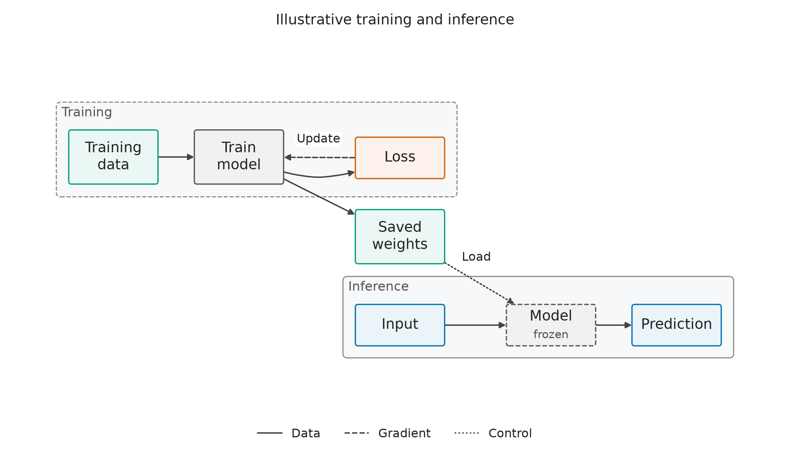

# scifig

**Scientific plots and architecture diagrams from reproducible Python or YAML.**

[](https://github.com/giacolees/scifig/actions/workflows/ci.yml)
[](pyproject.toml)
[](LICENSE)

scifig turns research tables and explicit architecture graphs into publication-sized
Matplotlib figures. Python, YAML and a coding-agent skill share the same validation,
styling and export machinery. The core library has no LLM dependency.

[Quick start](#quick-start) · [Python](#python-api) · [YAML](#declarative-yaml) ·
[Diagrams](#architecture-diagrams) · [Gallery](#gallery) · [Coding agents](#coding-agents)

| Learning dynamics | Training and inference |
| :---: | :---: |
| [](docs/gallery.md) | [](docs/diagrams.md) |

*Numerical examples use synthetic data. Architecture examples are illustrative;
none establishes a real comparison between methods.*

## Quick start

Requires **Python 3.11+**. Install from this repository with
[uv](https://docs.astral.sh/uv/):

```bash
git clone https://github.com/giacolees/scifig.git
cd scifig
uv sync --locked

# Render a learning curve from the supplied synthetic CSV.
uv run scifig render examples/specs/learning_curve.yaml

# Render a model diagram without installing Graphviz.
uv run scifig render examples/diagrams/encoder_decoder.yaml
```

Both commands write **PDF, SVG and PNG** to `docs/gallery/`, along with a resolved
YAML specification. Diagrams also save a layout JSON record. Rendering works in
headless environments.

Using pip instead? In an activated virtual environment, run
`python -m pip install -e .`, then use `scifig` and `python` without the `uv run` prefix.

## Python API

Pass a CSV/TSV path, pandas DataFrame, column mapping or list of records:

```python
from scifig import learning_curve

result = learning_curve(
    data="examples/data/learning_curve.csv",
    x="iteration",
    y="success_pct",
    group="method",
    uncertainty="std",
    labels={
        "x": "Training iteration",
        "y": "Success (%)",
        "title": "Synthetic learning dynamics",
        "legend": "Method (mean ± SD)",
    },
    style={
        "preset": "neurips",
        "height": 2.8,
        "colors": {"DAgger": "#0072B2", "AggreVaTe": "#D55E00", "BC": "#009E73"},
    },
)
result.export("figures", stem="learning_curve")  # PDF, SVG, PNG
```

Here, `std` explicitly requests a mean and one sample standard deviation at each
iteration. Keep the source data and code with the outputs. Native Matplotlib
objects remain available as `result.figure` and `result.ax`; review caveats in
`result.diagnostics`.

Styles are configuration: choose `publication`, `neurips` or `journal`, then set
physical width, height, fonts, colors or rc overrides. Presets are starting points,
not guarantees of venue compliance. See the [API guide](docs/api.md).

## Declarative YAML

Save this as `figure.yaml` in the repository root:

```yaml
figure:
  type: learning_curve
  data: examples/data/learning_curve.csv
  x: iteration
  y: success_pct
  group: method
  uncertainty: std
  labels:
    x: Training iteration
    y: Success (%)
    title: Synthetic learning dynamics
  style:
    preset: neurips
    width: single_column
    height: 2.8
    colors:
      DAgger: '#0072B2'
      AggreVaTe: '#D55E00'
      BC: '#009E73'
  export:
    directory: figures
    stem: learning_curve
    formats: [pdf, svg, png]
```

```bash
uv run scifig validate figure.yaml
uv run scifig render figure.yaml
uv run scifig templates list
uv run scifig styles list
```

Paths resolve relative to the YAML file. Unknown options, duplicate YAML keys,
malformed rows and invalid numeric values fail with actionable errors.
`validate` checks the specification and its inputs; `render` also checks the drawn
figure for visual issues.

## Architecture diagrams

Describe components and connections explicitly. Manual positioning needs only the
core dependencies:

```python
from scifig import architecture

result = architecture(
    nodes={
        "input": {"label": "Input", "role": "input", "position": [0, 0]},
        "encoder": {"label": "Encoder", "position": [2, 0]},
        "output": {"label": "Output", "role": "output", "position": [4, 0]},
    },
    edges=[
        {"source": "input", "target": "encoder"},
        {"source": "encoder", "target": "output"},
    ],
    layout="manual",
)
result.export("figures", stem="architecture")
result.save_layout("figures/architecture.layout.json")
```

For automatic placement and routing, install the external
[Graphviz `dot` executable](https://graphviz.org/download/) and choose
`layout="graphviz"` without manual positions. Graphviz supplies geometry;
Matplotlib renders the final vector artwork.

Diagrams support groups, cardinal ports, skip connections, frozen modules, and
distinct data, gradient, control and feedback edges. Validation checks endpoints,
membership, declared feedforward cycles and supported explicit tensor shapes.
It does not trace a model or infer missing dimensions. The layout JSON records
geometry, the spec and tool versions; it is not a replay input format.

See the [diagram guide](docs/diagrams.md) for YAML, styling and current limitations.

## Gallery

Every preview has an executable source specification and vector exports.

| Example | Source | Vector output |
| --- | --- | --- |
| [Learning curves](docs/gallery/learning_curve.png) | [YAML](examples/specs/learning_curve.yaml) · [Python](examples/python_api.py) | [PDF](docs/gallery/learning_curve.pdf) · [SVG](docs/gallery/learning_curve.svg) |
| [Grouped benchmarks](docs/gallery/benchmark.png) | [YAML](examples/specs/benchmark.yaml) | [PDF](docs/gallery/benchmark.pdf) · [SVG](docs/gallery/benchmark.svg) |
| [Ablation studies](docs/gallery/ablation.png) | [YAML](examples/specs/ablation.yaml) | [PDF](docs/gallery/ablation.pdf) · [SVG](docs/gallery/ablation.svg) |
| [Distribution comparisons](docs/gallery/distribution.png) | [YAML](examples/specs/distribution.yaml) | [PDF](docs/gallery/distribution.pdf) · [SVG](docs/gallery/distribution.svg) |
| [Heatmaps](docs/gallery/heatmap.png) | [YAML](examples/specs/heatmap.yaml) | [PDF](docs/gallery/heatmap.pdf) · [SVG](docs/gallery/heatmap.svg) |
| [ML pipeline](docs/gallery/diagrams_ml_pipeline.png) | [YAML](examples/diagrams/ml_pipeline.yaml) | [PDF](docs/gallery/diagrams_ml_pipeline.pdf) · [SVG](docs/gallery/diagrams_ml_pipeline.svg) |
| [Encoder–decoder with skip connection](docs/gallery/diagrams_encoder_decoder.png) | [YAML](examples/diagrams/encoder_decoder.yaml) | [PDF](docs/gallery/diagrams_encoder_decoder.pdf) · [SVG](docs/gallery/diagrams_encoder_decoder.svg) |
| [Training and inference system](docs/gallery/diagrams_training_inference.png) | [YAML](examples/diagrams/training_inference.yaml) | [PDF](docs/gallery/diagrams_training_inference.pdf) · [SVG](docs/gallery/diagrams_training_inference.svg) |

Regenerate the plots with `uv run python examples/make_gallery.py`. With Graphviz
installed, regenerate the diagrams with `uv run python examples/make_diagram_gallery.py`.

## Coding agents

The [scientific-figures skill](skills/scientific-figures/SKILL.md) gives coding agents
such as Codex and Claude Code a bounded workflow: inspect the inputs and objective,
choose a template, preserve executable sources, render, inspect the PNG, and make
at most two revision renders. Quantitative results, connections and tensor sizes
must come from supplied evidence.

Example request:

> Create a publication-ready learning curve comparing DAgger, AggreVaTe and BC
> from experiments.csv. Explain the uncertainty bands and preserve the Python,
> specification, PDF, SVG and PNG.

For a diagram, supply the relevant code or an explicit architecture description.
See [skill installation and usage](docs/getting-started.md#agent-skill) for host-specific
instructions. Local workflow trials are recorded for [plots](docs/skill-validation.md)
and [diagrams](docs/diagram-skill-validation.md); live host discovery was not tested.

## Scientific and visual checks

- **Explicit statistics.** No silent dropping, imputation, smoothing or aggregation.
  Duplicate summary cells require an explicit aggregation choice or uncertainty.
- **Defined uncertainty.** `std` uses sample SD; `sem` uses SD/√n; `ci95` uses
  mean ± 1.96 SEM with an assumption warning. Supplied bounds are absolute endpoints.
  Boxplot whiskers reach the furthest observations within 1.5 IQR of each quartile.
- **Inspectable encodings.** Limits that clip data, truncated bar axes, saturated
  heatmap colors and ambiguous color mappings produce diagnostics; invalid log
  scales fail validation.
- **Final-size output.** Configurable physical dimensions, embedded TrueType PDF
  fonts, SVG font paths and redundant markers/dashes/hatches support publication use.
  Layout checks report clipping, crowding and diagram collisions.

Checks cannot establish experimental independence, scientific validity or venue
compliance. Inspect the preview at final size. Output is repeatable within a fixed
dependency/font environment; use separate processes for concurrent Matplotlib
rendering. Bootstrap intervals, paired-run inference, multi-panel composition,
nested diagram groups and automatic model tracing are outside the current scope.

## Documentation and development

| Guide | Contents |
| --- | --- |
| [Getting started](docs/getting-started.md) | Installation, data conventions and agent skill setup |
| [Python and YAML API](docs/api.md) | Column roles, statistics, styles and export options |
| [Architecture diagrams](docs/diagrams.md) | Graph specifications, layouts and validation |
| [Contributing](docs/contributing.md) | Adding templates and checking visual changes |
| [Architecture decisions](docs/architecture.md) | Separation of concerns and extension contracts |
| [Validation record](docs/validation.md) | Tested environments, exports and known limitations |
| [Reference research](docs/research.md) | Sources, techniques and licensing constraints |

```bash
uv sync --locked --extra dev
uv run pytest -q
uv run ruff check .
uv run ruff format --check .
uv build
```

GitHub Actions runs the tests, renders both galleries and builds the distributions
on Linux and macOS with Python 3.11–3.13. For bugs and feature requests, use
[GitHub Issues](https://github.com/giacolees/scifig/issues).

## License and references

scifig's original code is [MIT licensed](LICENSE). Its design draws on
[figures4papers](https://github.com/ChenLiu-1996/figures4papers),
[Nicolas P. Rougier's Scientific Visualization book](https://github.com/rougier/scientific-visualization-book)
and [ResearchFigure](https://github.com/DaoD/ResearchFigure).
No source code, fonts, datasets or figures from those projects are vendored;
see the [research and licensing review](docs/research.md) for attribution and constraints.
