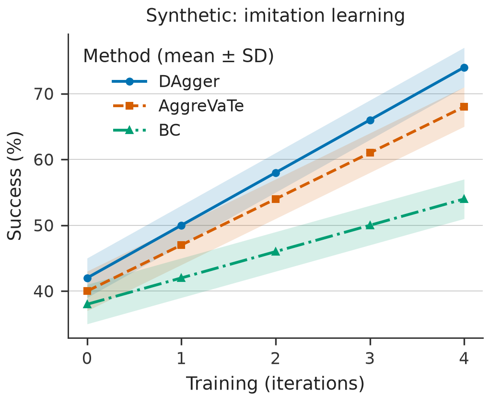

# scifig

[](https://github.com/giacolees/scifig/actions/workflows/ci.yml)

Create reproducible, publication-sized scientific figures from Python or YAML.
Five Matplotlib templates share one validation, style and export engine. A separate
agent skill supports Codex and Claude Code without an LLM dependency in the library.
Architecture diagrams use an explicit graph of nodes, connections and boundaries,
with optional Graphviz layout and the same Matplotlib vector rendering and styles.

```bash
git clone https://github.com/giacolees/scifig.git
cd scifig
python -m pip install -e .
scifig render examples/specs/learning_curve.yaml
python examples/make_gallery.py
```

Or use the locked development environment: `uv sync --extra dev`, then prefix
commands with `uv run`. Python 3.11+ is required. Rendering works headlessly.

```python
from scifig import learning_curve

result = learning_curve(
    data="examples/data/learning_curve.csv",
    x="iteration",
    y="success_pct",
    group="method",
    uncertainty="std",
    style="neurips",
    labels={"x": "Training iteration", "y": "Success (%)", "title": "Synthetic learning dynamics"},
)
result.savefig("figures/learning_curve.pdf")
result.export("figures", stem="learning_curve")  # PDF, SVG, PNG
# Native Matplotlib objects remain editable:
ax, fig = result.ax, result.figure
```

The example data is **synthetic**, not evidence of real method performance.

```yaml
figure:
  type: learning_curve
  data: ../data/learning_curve.csv
  x: iteration
  y: success_pct
  group: method
  uncertainty: std
  labels: {x: Training iteration, y: 'Success (%)', title: Synthetic learning dynamics}
  style: {preset: neurips, width: single_column}
  export: {formats: [pdf, svg, png], directory: ../../figures, stem: learning_curve}
```

Paths are relative to the YAML file. `scifig render` also saves a resolved YAML
specification alongside the outputs; keep its source data to reproduce the figure.

```bash
scifig validate examples/specs/learning_curve.yaml
scifig templates list
scifig styles list
```

Create a diagram using the same CLI:

```bash
scifig render examples/diagrams/encoder_decoder.yaml
```

The manual-layout example needs no additional dependency. For automatic routing,
install the external [Graphviz](https://graphviz.org/download/) `dot` executable,
then run `python examples/make_diagram_gallery.py`.

```python
from scifig import architecture

result = architecture(
    nodes={
        "x": {"label": "Input", "role": "input", "position": [0, 0]},
        "model": {"label": "Encoder", "position": [2, 0]},
    },
    edges=[{"source": "x", "target": "model"}],
    layout="manual",
)
result.export("figures", stem="architecture")
```

[Diagram guide and three examples](docs/diagrams.md) cover pipelines, skip
connections, and training/inference boundaries. Diagram validation checks the
supplied graph; it does not infer an architecture or unspecified tensor sizes.

| Template | Long-table columns | Statistical behavior |
| --- | --- | --- |
| `learning_curve` | numeric `x`, `y`, optional `group` | Sorted trajectories and optional uncertainty bands |
| `benchmark` | categorical `x`, numeric `y`, optional `group` | Grouped bars, optional intervals; complete group grid |
| `ablation` | categorical `x`, numeric `y` | Ordered bars with optional values and intervals |
| `distribution` | categorical `x`, numeric `y` | Tukey boxplots and every raw observation |
| `heatmap` | categorical `x`, `y`, numeric `value` | Vector cells in a complete rectangular grid |



[Five-family gallery](docs/gallery.md) · [Getting started](docs/getting-started.md) ·
[API and specification](docs/api.md) · [Agent skill](skills/scientific-figures/SKILL.md) ·
[Contributing](docs/contributing.md) · [Research and licenses](docs/research.md) ·
[Architecture](docs/architecture.md) · [Validation results](docs/validation.md)

No aggregation, smoothing, dropping or imputation occurs silently. Duplicate
summary cells require explicit `aggregate: mean|median` or sample uncertainty.
`std` is sample SD, `sem` is SD/√n, and `ci95` is mean ± 1.96 SEM with an
assumption warning. None establishes independent runs or inferential validity.
Provided `{lower: lo, upper: hi}` bounds are absolute endpoints. Distribution
whiskers are 1.5 IQR, not confidence intervals.

Presets (`publication`, `neurips`, `journal`) are configurable starting dimensions,
not venue compliance claims. Fonts, widths, palettes, labels, legend placement and
Matplotlib rc settings can be changed without modifying templates. PDF embeds
TrueType fonts; SVG defaults to font paths. Use an explicit category-to-color map
across related figures. Automatic stable hashes can collide and warn.

```text
src/scifig/
  core/           # validated specs, table ingestion, callable registry
  diagrams/       # graph specs, optional layout, vector artists and diagnostics
  styles/         # physical sizes, typography, palettes
  templates/      # five small plotting functions
  rendering/      # common engine, editable result, scoped vector/raster export
  validation/     # scientific contracts and rendered-geometry diagnostics
  cli.py
skills/scientific-figures/SKILL.md
examples/         # synthetic CSVs, YAML specs and executable Python
tests/            # validation, rendering, export, CLI and image checks
docs/             # research, architecture, guides and actual gallery exports
.github/workflows/ci.yml
pyproject.toml
uv.lock
```

Run checks with `uv run pytest -q`, `uv run ruff check .`, and
`uv run ruff format --check .`. Build a wheel and source archive with `uv build`.

Initial scope: one axes per figure (plus a heatmap colorbar), CSV/TSV/in-memory
tables, three simple uncertainty estimators, and one architecture diagram family.
Rendering uses Matplotlib; optional Graphviz provides diagram geometry. Layout diagnostics
are heuristics; inspect previews at final publication size. Use separate processes
for concurrent rendering because Matplotlib settings are process-global. Output is
repeatable within a fixed dependency/font environment; cross-platform bytes can
differ. Next additions should be driven by real data: paired-run identifiers,
bootstrap intervals, multi-panel composition and more flexible missing-cell handling.

MIT-licensed original code. No code, data, images or fonts from the reference
repositories are vendored. Their distinct licensing constraints are recorded in
[research.md](docs/research.md).
